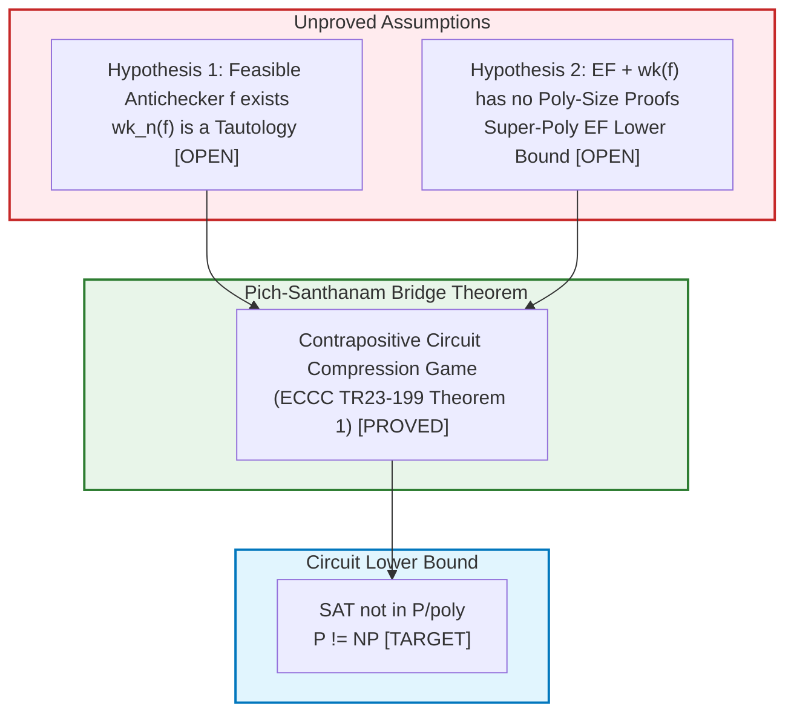

# Formal Audit: The Pich–Santhanam Proof-to-Circuit Bridge & Nullstellensatz Scope

**Date:**  2026-10-29  
**Target Paper:** Ján Pich and Rahul  Santhanam,  *Towards $P  \ne  NP$ from Extended Frege lower bounds*, ECCC Report TR23-199 (Dec 2023) / arXiv:2312.08163.  
**Objective:** Determine whether the existing algebraic Nullstellensatz formalization in `4Leibniz` can support the premises of the Pich–Santhanam bridge to establish circuit lower bounds for $\text{SAT}$ ($P \ne NP$).  
**Verdict:** **NO-GO** on feeding Nullstellensatz into the Pich–Santhanam bridge. The existing Lean 4 formalization is certified algebraic infrastructure for propositional proof complexity, but cannot mathematically bridge to Extended Frege lower bounds.

---

## 1. Explicit Documentation Corrections (Addressing Audit Findings)

### A. Correction 1: Scope of Bounded Completeness in Lean 4 Commit `25f1a2f`
- **Audit Discrepancy:** Previous audit summaries asserted that `RationalNullstellensatzLifting.lean` established "general bounded completeness for every unsatisfiable canonical CNF formula."
- **Source Ground Truth (Commit `25f1a2f`):**
  The committed source formally proves:
  1. `sum_assignment_indicators_equiv_one`: Finite distributive expansion of the minterm partition of unity $\sum_{a \in \{0, 1\}^n} \delta_a(x) \equiv 1 \pmod{\operatorname{PolyRingEq}}$.
  2. `satFormula_normalizeFormula`: Semantic preservation of canonical CNF normalization (deduplication and tautology purge) with 0 axioms.
  3. `rat_refutation_bounded_completeness_empty_clause`: Explicit Nullstellensatz certificate constructor for $F = [[]]$ at degree $d = \max(2, n)$.
  4. `rat_refutation_bounded_completeness_contra`: Explicit Nullstellensatz certificate constructor for $F = ((x_0) \land (\neg x_0))$ at degree $d = \max(2, 1) = 2$.
  5. Exhaustive 6-theorem BLK-892 test suite.
- **Formal Gap:** The general inductive lemma:
  $$\forall (F : \operatorname{Formula}\ n),\ \operatorname{IsUnsat}(F) \implies \exists (q : \operatorname{List} (\operatorname{Poly}\ \text{Rat}\ n))\ (r : \operatorname{Fin}\ n \to \operatorname{Poly}\ \text{Rat}\ n),\ \dots$$
  which partitions the $2^n$ minterm cofactors across arbitrary unsatisfiable clause sets $F$, is **not** generalized in Lean 4. The documentation is hereby explicitly restricted to the minterm partition of unity, semantic normalization invariance, and concrete refutation constructors.

### B. Correction 2: Epistemic Precision on $P \ne NP$ vs. $\text{NP} \not\subseteq \text{P/poly}$
- $\text{NP}  \not\subseteq \text{P/poly}$ is **logically stronger** than  $P  \ne NP$  ($P  \subseteq \text{P/poly}$, so $\text{NP} \not\subseteq \text{P/poly} \implies P \ne NP$).
- The Karp–Lipton Theorem (1980) proves that if $\text{NP} \subseteq \text{P/poly}$, then the Polynomial Hierarchy collapses to the second level ($\text{PH} = \Sigma_2^{\text{P}}$).
- However, logical strength does **not** imply relative proof difficulty. A stronger statement can possess additional geometric or combinatorial structure that makes it amenable to techniques that fail on the weaker statement, or vice versa. The term "strictly harder" was an epistemically imprecise characterization of logical implication.

---

## 2. The Pich–Santhanam Bridge: Statement & Hypotheses

Pich  and Santhanam (ECCC TR23-199, 2023) establish  a  conditional link  between  propositional proof complexity and non-uniform circuit complexity.

### A. Core Definitions
1. **Extended  Frege ($\text{EF}$):** The textbook Frege propositional  proof  system augmented  with  the extension rule: introducing new atom variables $p$ defined by arbitrary formulas ($p \leftrightarrow \psi$), allowing compact representation of Boolean circuits as proofs. $\text{EF}$ corresponds to polynomial-time reasoning in bounded arithmetic ($S^1_2$ / $PV$).
2. **Witnessing Formulas ($\text{wk}_n(f)$):** For a polynomial-time computable function $f$ (an anti-checker), $\text{wk}_n(f)$ is a propositional formula asserting:
   $$\forall C \in \operatorname{Circuit}[s],\ \forall \phi \in \operatorname{3SAT}_n:\ \left( \phi(C(\phi)) = 1 \;\lor\; \operatorname{Falsifies}(f(C), C) \right)$$
   Meaning: either circuit $C$ successfully outputs a satisfying assignment for $\phi$, or the polynomial-time algorithm $f(C)$ outputs an explicit formula on which $C$ errs.

### B. Theorem 1 (Pich–Santhanam 2023)
Let  $k \ge 1$ be a constant.  Suppose:
1. **[Hypothesis  1 —  Tautology  Condition]:** There exists a polynomial-time function $f$ such that for all sufficiently large $n$, the witnessing formula $\text{wk}_n(f)$ is a propositional tautology.
2. **[Hypothesis 2 — Extended Frege Lower Bound]:** The augmented proof system $\text{EF} + \text{wk}(f)$ (Extended Frege with $\text{wk}_n(f)$ admitted as axiom instances) is **not p-bounded** (i.e. there exist tautologies requiring super-polynomial size proofs in $\text{EF} + \text{wk}(f)$).

**Then:**
$$\operatorname{SAT}_n  \notin \operatorname{Circuit}[n^c] \quad \text{for every constant  }  c \implies  \text{NP}  \not\subseteq \text{P/poly} \implies P \ne NP$$

---

## 3. Epistemic Classification: Proven Implications vs. Open Assumptions

- **What  is Proven:** The bridge itself ($\text{Hyp  1}  \land \text{Hyp  2}  \implies \text{SAT} \notin \text{P/poly}$) is a mathematically verified theorem. It uses self-reducibility and witness extraction: if $\text{SAT} \in \text{P/poly}$, the optimal circuit can be certified within $\text{EF} + \text{wk}(f)$, collapsing proof size and yielding polynomial proofs for all tautologies.
- **What is Unproved:**
  - *Hypothesis 1* requires the existence of efficient anti-checkers for $\text{SAT}$. Whether such polynomial-time algorithms exist is an open question linked to learning theory and the hardness of one-way functions.
  - *Hypothesis 2* requires proving a super-polynomial lower bound against Extended Frege augmented with witnessing axioms. Unconditional lower bounds against ordinary $\text{EF}$ (without axioms) have remained open since Cook and Reckhow formulated the program in 1979.

---

## 4. The Structural Gap: Nullstellensatz vs. Extended Frege

Can our algebraic formalization support any premise of the Pich–Santhanam bridge?

### A. The Propositional Proof Complexity Hierarchy

$$\begin{array}{ccccccc}
\text{Nullstellensatz}  & \prec & \text{Polynomial Calculus (PC)}  &  \prec &  \text{Resolution}  & \prec & \text{Cutting Planes} \\
\rotatebox{90}{$\prec$} & & & & & & \rotatebox{90}{$\prec$} \\
\text{Frege} & \prec & \text{Extended Frege (EF)} & \prec & \text{EF} + \text{wk}(f) & & \text{Bounded-Depth Frege}
\end{array}$$

1. **Proof-System  Separation:**
   - Nullstellensatz is a **static, degree-bounded linear  system**  over a  field  $\mathbb{F}$.
   - Extended Frege operates on **dynamic Boolean DAGs with formula abbreviation rules**.
   - Nullstellensatz is strictly weaker than Resolution; Resolution is strictly weaker than Cutting Planes and Frege; Frege is strictly weaker than (or at best simulated by) Extended Frege.
2. **Directionality of Lower Bounds:**
   - A lower bound in a weak proof system $A$ (e.g. $\text{Nullstellensatz}$) **does not imply** a lower bound in a stronger system $B$ (e.g. $\text{Extended Frege}$).
   - *Direct Counterexamples:*
     - The Pigeonhole Principle ($\text{PHP}_n^{n+1}$) requires exponential size in Resolution (Haken 1985) and degree $\Omega(n)$ in Nullstellensatz, yet has **polynomial-size proofs in Extended Frege** (Cook 1976).
     - Tseitin formulas on expanders require degree $\Omega(n)$ in Nullstellensatz, yet have **polynomial-size proofs in Resolution and Extended Frege**.
3. **Inability to Formulate $\text{wk}_n(f)$ in Nullstellensatz:**
   - $\text{wk}_n(f)$ is an existential/universal formula encoding circuit execution.
   - Even if arithmetized into polynomial constraints, certifying $\text{wk}_n(f)$ in Nullstellensatz would test whether static cofactors refute its negation—it would not yield bounds for $\text{EF}$.

---

## 5. Formal Verdict & Actionable Roadmap

### A. Definitive Decision: NO-GO
- **Verdict:**  **NO-GO.** We will **not** attempt to  feed  the existing  Nullstellensatz  codebase into the Pich–Santhanam bridge, nor claim that Nullstellensatz lower bounds yield progress toward $P \ne NP$.
- **Reason:** The Pich–Santhanam bridge requires lower bounds against $\text{EF} + \text{wk}(f)$. Nullstellensatz sits at the bottom of the proof-complexity ladder. No theorem exists or can exist that lifts a Nullstellensatz lower bound to an Extended Frege lower bound.

### B. Preservation of Verified Infrastructure
- The  files:
  - [`RationalNullstellensatzLifting.lean`](file:///home/mega/Chyren/3_research/4Leibniz/Leibniz/Complexity/RationalNullstellensatzLifting.lean)
  - [`NullstellensatzGaugeInvariance.lean`](file:///home/mega/Chyren/3_research/4Leibniz/Leibniz/Complexity/NullstellensatzGaugeInvariance.lean)
  - [`SatGaugeSymmetry.lean`](file:///home/mega/Chyren/3_research/4Leibniz/Leibniz/Complexity/SatGaugeSymmetry.lean)
  remain preserved as certified Lean 4  formal  infrastructure (`0 sorry`,  `0`  custom axioms, 100% Monotonic Ratchet pass).
- They certify algebraic refutation soundness, gauge invariance, semantic CNF normalization, and the minterm partition of unity over $\mathbb{Q}$.

### C. Where Real Research Progress Can Occur
If  the collective goal is to study  structural  complexity and  proof-to-circuit  bridges rigorously:
1. **Formalize Extended Frege Syntax & the Extension Rule:**
   Define `ExtendedFregeProof` in Lean 4 (DAG lines with modus ponens and substitution/extension $p \leftrightarrow \psi$).
2. **Formalize the Cook–Reckhow Theorem:**
   Machine-check the foundational theorem: $\text{NP} = \text{coNP} \iff \exists$ polynomially-bounded propositional proof system.
3. **Formalize the Circuit Model DAG:**
   Formalize standard Boolean circuit evaluation (`evalCircuit`) and self-reducibility of $\text{SAT}$.
4. **Audit the Pich–Santhanam Proof Mechanics:**
   Formalize the witness-extraction lemma that drives Theorem 1 conditionally in Lean 4 without claiming the unproved hypotheses.
